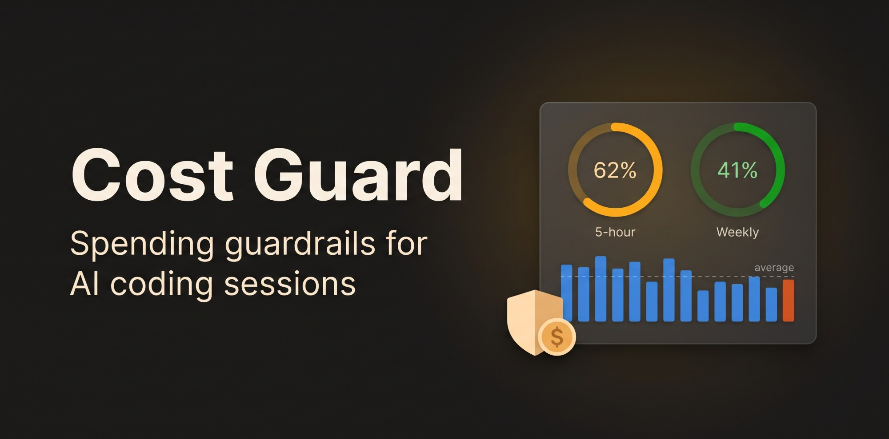
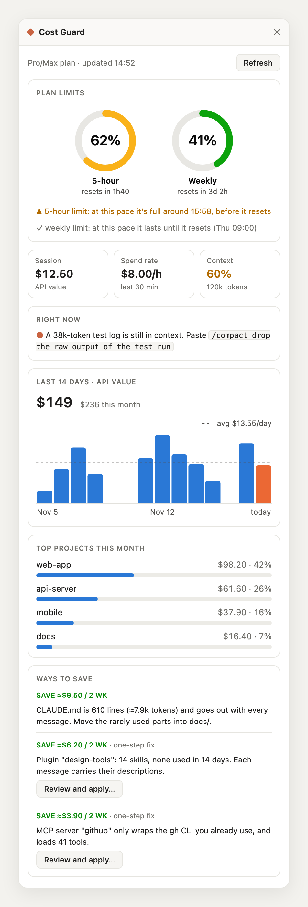

<p align="center">
  
</p>

<h1 align="center">Cost Guard</h1>

<p align="center">
  <b>Stop surprise Claude Code bills, and see your Pro/Max limits before you hit them.</b><br>
  Caps that actually stop a runaway session, 5-hour and weekly limit warnings with pace,<br>
  and one-step fixes for what wastes tokens on every message.
</p>

<p align="center">
  
  
  
  
</p>

<p align="center">
  <a href="#install">Install</a> ·
  <a href="#what-it-does">What it does</a> ·
  <a href="#pro-max-and-ultra-plans">Pro/Max plans</a> ·
  <a href="#the-cost-guard-pane">The pane</a> ·
  <a href="#commands">Commands</a> ·
  <a href="#faq">FAQ</a>
</p>

---

## Why this exists

One Claude Code session cost **$239.73**, and **$214 of it (89%) was cache writes**, not
code. The prompt cache expires after a pause. The next message then re-writes the whole
context at up to twice the input price, and a long session does that again and again.

Nothing warned about it, and nothing stopped it. Cost Guard does both:

- It **stops** the prompt, and the tool call in the middle of a turn, when a cap is reached. A
  long autonomous run stops too, not only the next message.
- It **pauses once** before an idle session re-caches a large context, and shows the price
  first ("idle 22 h, re-caches 612k tokens ≈ $4.90").
- It **trips a breaker** when a session spends $15 in 15 minutes, which is usually a loop.
- On a **Pro or Max plan** it warns at 80% and 95% of the 5-hour and weekly limits. It says
  when you'll run out at this pace, and it never blocks you.

## Install

```bash
claude plugin marketplace add dimohamdy/cost-guard
```

```bash
claude plugin install cost-guard@team-cost-tools
```

For the live pane (desktop app and terminal), also run:

```bash
claude plugin install cost-guard-panel@team-cost-tools
```

Restart any open sessions. Optionally, add the status line inside Claude Code:

```
/cost-guard:statusline
```

That's it. The defaults suit most people: a $100 session cap, a $150 daily cap and a $300
monthly budget, with warnings at 80%. On a plan, it uses your plan's limits instead.

<details>
<summary>Other ways to install</summary>

- **Inside Claude Code:** `/plugin marketplace add dimohamdy/cost-guard`, then
  `/plugin install cost-guard@team-cost-tools`.
- **Desktop app:** click **+** next to the prompt box → **Plugins** → **Add marketplace** →
  `dimohamdy/cost-guard`, then add both plugins.
- **From a clone:** `git clone https://github.com/dimohamdy/cost-guard`, then pass the
  clone's path to `claude plugin marketplace add`. Edits show up without a push.

Each developer installs it for themselves, so no admin rights are needed.
</details>

## What it does

<table>
<tr>
<td width="50%" valign="top">

### 🛑 Stops runaways
- **Hard caps** per session, per day and per month. It denies tool calls mid-turn.
- **Runaway breaker:** more than $15 in 15 minutes pauses the next tool call once.
- **Cold-cache stop:** before an idle session re-caches a big context, it shows the price
  once.
- `#override` in your message lets one more cap-sized amount through.

</td>
<td width="50%" valign="top">

### ⏱️ Knows your plan
- It detects **Pro, Max and Ultra** from the limits Claude Code reports.
- **5-hour and weekly** warnings at 80% and 95%, with the time you'll run out at this pace.
- It **never blocks** a prompt because of a plan limit.
- Behind a **company gateway**, it uses the real spend limit.

</td>
</tr>
<tr>
<td width="50%" valign="top">

### 💸 Finds what wastes tokens
- **Unused plugins, skills, agents and MCP servers** that go out with every message.
- **Oversized CLAUDE.md and MEMORY.md** files, and hooks that inject text.
- **Large tool output** still in context, with a `/compact` line you can paste.
- **`/cost-guard:fix`** applies a tip in one step and can **undo** it.

</td>
<td width="50%" valign="top">

### 📊 Shows where it went
- A **live pane** in the desktop app, with a text version in the terminal.
- A **status line**: `5h ▓▓▓░░ 62% ↻1h40 · wk ▓▓░░░ 41% ↻Thu`.
- **Reports** by session, project, model or day, also as JSON.
- **Desktop notifications** when a cap or limit is near.

</td>
</tr>
</table>

## The Cost Guard pane

<table>
<tr>
<td width="46%" valign="top">
<picture>
  <source media="(prefers-color-scheme: dark)" srcset="assets/pane-dark.png">
  
</picture>
</td>
<td valign="top">

The `cost-guard-panel` plugin keeps a **Cost Guard** pane next to the chat in the Claude
Code desktop app. It shows:

- **Plan limits** as rings, each with its reset countdown and an "at this pace" line. On an
  API key it shows today and the month against your caps.
- **This session**: its cost, spend rate and how full the context is.
- **Right now**: the one thing to drop from the context.
- **The last 14 days**, with today highlighted, and your **top projects**.
- **Ways to save**: a **Review and apply…** button opens `/cost-guard:fix`, which asks
  before it changes anything.

The pane refreshes after each reply and every minute. `/cost-panel` opens it again. When
something needs attention, one line appears above the prompt:

```
◆ Cost Guard: 5-hour limit at 86% · resets in 1h39   [Details] [Hide]
```

</td>
</tr>
</table>

### In the terminal

The same plugin draws a text version in `claude`:

```
◆ Cost Guard · Pro/Max plan · updated 00:53            [Refresh]

5-hour  ███████████████░░░░░░░░░  62%  resets in 1h39
Weekly  ██████████░░░░░░░░░░░░░░  41%  resets in 3d 2h
        ▲ full around Wed 14:00 at this pace, before it resets
Session $12.50 API value  $8.00/h  ctx 120k 60%

14 days ·▂▂▃▃▄▄▅▅▆▆▇▇█  $91.00 · avg $7.00/day
        Nov 5        ▲ today

Top projects this month
app                █████░░░░░░░░░░░░░░░░░░░  19%  $40.00

Ways to save
1. ≈$9.50 Trim CLAUDE.md
2. ≈$3.90 Disable plugin x
```

- In fullscreen at 110+ columns, the pane docks beside the chat. Otherwise it sits above
  the prompt in a shorter form.
- `/cost-panel` opens it at any width. It opens by itself only at 144+ columns.
- **Hide** on the alert line dismisses that alert until something changes.

## Every rule, at a glance

| Situation | What happens |
|---|---|
| Session passes $10 / $25 / $50 | A one-time alert in the chat (it does not block) |
| A session, the day or the month reaches **80%** of its cap | A one-time warning that includes the pace, for example "at ≈$40/h the session cap is reached in ~25 min" |
| Session passes **$100** | New prompts are **blocked**, and tool calls are **denied mid-turn**, so a long autonomous run also stops |
| This machine passes **$150 today** (all sessions) | Same block |
| This machine passes the **$300 monthly budget** | A warning once a day. Turn on `monthly_hard_stop` to block instead |
| A session spends **more than $15 in 15 minutes** | The **runaway breaker** pauses the next tool call once. That much spend usually means a loop or a huge context |
| You come back to an idle session with a big context | Blocked **once** with the cost of re-caching it. Re-send to continue, or `/clear` |
| You start a session (once a day) | The top 3 cost cuts from your last 14 days, each with its fix |
| Context passes **150k tokens** | A one-time note on what fills it and what to drop |
| A stop or a cap warning, while you're away | A **desktop notification** (macOS, or Linux with `notify-send`) |
| Status line (optional) | `Opus 5.5 · session $12.34 · today $40.10 · month $210.00 · $18.20/h · ctx 612k · cache cold` |

To get past a stop, put `#override` in your message. The plugin never blocks the app's own
bookkeeping tools (task list, wrap-up, plan mode). You can change that list with
`"never_block": [...]` in `overrides.json`.

## Pro, Max and Ultra plans

A plan has no per-token bill. What runs out is the **5-hour limit** and the **weekly
limit**. Claude Code reports both, and Cost Guard detects a plan from them
(`/cost-guard:limits billing auto`, the default). On a plan:

- **Warnings:** at 80% of either window and again at 95%, once per window, plus a desktop
  notification. For example: "weekly limit 82% used · at this pace it's full around Wed
  14:00, before it resets · resets Thu 09:00 (in 1d 19h)".
- **No blocking:** Cost Guard never blocks a prompt because of a plan limit.
- **Dollar caps don't apply.** Dollar amounts become "API value": what the same usage would
  cost on an API key.
- **Still on:** the runaway breaker and the cold-cache stop. A loop or a large re-cache uses
  up the 5-hour limit just as fast.
- **Status line:** `5h ▓▓▓░░ 62% ↻1h40 · wk ▓▓░░░ 41% ↻Thu · ≈$12.34 API value`.

Behind a company gateway that sets a spend limit, Cost Guard uses that real budget. It warns
at 80%, and blocks only with `stop-monthly on`.

Claude Code sends the limits only to the status line and to desktop mods. So Cost Guard
reads them through `/cost-guard:statusline` in the terminal, and through the pane in the
desktop app. Billing is decided **per session**: a desktop session on a plan doesn't change
an API-key session in the terminal.

## Find and fix what wastes tokens

At the start of a session, once a day, Cost Guard shows the top 3 savings with the fix for
each. `/cost-guard:insights [days]` (14 by default) shows the full list. It reads every
recent transcript, subagents included, and finds what goes out with **every** message, and
how often it was used:

- **Plugins whose skills were never used.** It warns you when the plugin also provides an
  MCP server you do use.
- **Personal skills and custom agents that were never used**, and descriptions that are too
  long.
- **MCP servers** that were never called, that only wrap a CLI you already have (`gh`,
  `kubectl`, …), or that load more than 20 tools.
- **CLAUDE.md and MEMORY.md files** over 300 lines or 2.5k tokens.
- **Large skills that run often**, and **hooks** that inject text at session start.

`/cost-guard:fix` lists what it can change, asks which items to apply, and applies only
those:

| Fix | What it does | Undo |
|---|---|---|
| Unused plugin | `claude plugin disable <plugin>` | `claude plugin enable <plugin>` |
| Unused personal skill or agent | moves it to `~/.claude/skills-off/` or `~/.claude/agents-off/` | moves it back |
| Unused MCP server from `~/.claude.json` | `claude mcp remove` (its config is saved first) | `claude mcp add-json` with the saved config |

`/cost-guard:fix undo` reverses the last change, and `/cost-guard:fix undo all` reverses all
of them. App connectors and hooks can't be changed automatically, so for those it gives you
the steps.

### Context advice

Run `/cost-guard:context` at any time. Each alert and stop also includes the top two
points:

- **Large tool output still in context**, with a `/compact drop the raw output of …` line
  you can paste as is.
- **Wasteful reads**: lock files, generated or minified files, and full test logs (run only
  the failing test, or pipe through `| tail -50`).
- **The same file read 3 or more times**, and **images** still in context.
- **A large context**, broken into its parts. Use `/clear` for a new task or `/compact` for
  the same task.
- **Subagents** that cost more than 30% of the session, and **Opus or Fable** sessions where
  Sonnet would do.

## Commands

| Command | What it does |
|---|---|
| `/cost-guard:limits` | Show or change the caps, alerts and billing mode |
| `/cost-guard:report` | Where the money went, by session, project, model or day |
| `/cost-guard:insights` | What goes out with every message without being used |
| `/cost-guard:fix` | Apply those tips, with undo |
| `/cost-guard:context` | What fills this session's context, and what to drop |
| `/cost-guard:statusline` | Add cost and plan limits to the status line |
| `/cost-panel` | Open the Cost Guard pane (with `cost-guard-panel`) |

<details>
<summary><b>Change the limits</b></summary>

The plugin options set defaults for everyone (`/config` → Cost Guard, or
`/plugin configure cost-guard@team-cost-tools`). The command overrides them on your machine,
and project limits override both inside their folder:

```
/cost-guard:limits                   show the current limits and where each comes from
/cost-guard:limits session 50        session cap $50
/cost-guard:limits daily 200         daily cap $200
/cost-guard:limits monthly 300       monthly budget $300
/cost-guard:limits stop-monthly on   block at the monthly budget instead of warning
/cost-guard:limits pct 80            warning at 80% of each cap
/cost-guard:limits burst 15          runaway breaker at $15 per 15 minutes (0 = off)
/cost-guard:limits notify off        no desktop notifications
/cost-guard:limits project session 20   a $20 session cap in this folder only
/cost-guard:limits billing plan      treat this machine as a Pro/Max plan (auto detects it)
/cost-guard:limits alerts 5,20,40    alert amounts
/cost-guard:limits cold 2            cold-cache warning threshold
/cost-guard:limits context 200       context advice at 200k tokens
/cost-guard:limits tips 7            cost tips at most weekly (0 = off)
/cost-guard:limits ignore claude-mem never suggest this again
/cost-guard:limits reset             back to the plugin options (keeps ignores and project limits)
/cost-guard:limits ignore clear      show every tip again
```
</details>

<details>
<summary><b>Reports</b></summary>

```
/cost-guard:report                  today, by session
/cost-guard:report week by project  last 7 days, per project folder
/cost-guard:report month by model   this month, per model
/cost-guard:report 30 by day json   JSON, for scripts or a spreadsheet
```
</details>

## FAQ

**Does it send my data anywhere?**
No. It reads the transcripts Claude Code already keeps in `~/.claude/projects`, and stores
its state in `~/.claude/plugins/data/cost-guard-team-cost-tools`, readable only by you
(0600). It is one Python file that uses only the standard library and makes no network
calls.

**I'm on Pro or Max. Will it block me?**
No. On a plan it only warns, at 80% and 95% of the 5-hour and weekly limits. The runaway
breaker and the cold-cache stop still pause once, because a loop uses up your 5-hour limit
just as fast. Re-send to continue.

**How accurate are the dollar amounts?**
They're estimates from list prices applied to your transcripts, subagents included. A
company gateway may bill differently. You can set your own prices in `overrides.json`
(see [Honest limits](#honest-limits)).

**Can a team use it?**
Yes. Each person installs it, and the plugin options set shared defaults. Real enforcement
(org spend limits, gateway budgets) still needs an admin, because anyone can turn a plugin
off.

**What if it breaks?**
It fails open: if the guard crashes, Claude Code keeps working, and the error goes to
`state/errors.log` in its data folder.

## Honest limits

- **It's an estimate.** It uses list prices from the local transcripts. To change prices, add
  `"prices": {"claude-opus-5-5": [input, output, cache_read]}` (USD per 1M tokens) to
  `~/.claude/plugins/data/cost-guard-team-cost-tools/overrides.json`.
- **It's per machine and voluntary.** Anyone can disable it.
- **It checks when you send a prompt and before each tool call.** A single model response
  can't be stopped halfway through, so a session can go slightly over a cap.
- **The first scan of a month runs in the background.** Until it finishes, the monthly figure
  is left out. The plugin never guesses it.
- **Parallel sessions share one data folder.** Writes are atomic, and totals are rebuilt from
  transcript offsets.

## Development

```bash
python3 -m unittest discover -s tests -v
```

```bash
claude plugin validate plugin
```

```bash
claude plugin validate panel && claude plugin test panel
```

The tests use a temporary HOME and synthetic transcripts, so they never touch real data.

```
.claude-plugin/marketplace.json   marketplace "team-cost-tools"
plugin/.claude-plugin/plugin.json manifest and the limit options
plugin/hooks/hooks.json           SessionStart, UserPromptSubmit, PreToolUse
plugin/commands/                  /cost-guard:limits, :report, :context, :insights, :fix, :statusline
plugin/scripts/cost_guard.py      all logic (Python 3, standard library only)
panel/                            the pane (a Claude Code mod; reads cost_guard.py panel-json)
tests/test_cost_guard.py          unit tests
```

Issues and pull requests are welcome. If Cost Guard flagged something it shouldn't have, or
missed a waste it should catch, please [open an issue](https://github.com/dimohamdy/cost-guard/issues)
with the output of `/cost-guard:insights`.

## Credits

Ideas were adapted from other open tools:
- **claude-session-cost**: transcript-based cost tracking and private state files.
- **cost-gate**: warning at a percentage of the budget.
- **ccusage**: burn rate; reports by period, project and model; JSON output.
- **claude-code-tokenbudget**: monthly quotas.
- **context-budget**, **unclog** and **token-optimizer**: setup audits of CLAUDE.md files,
  agents, unused MCP servers and wrapper servers.

Cost Guard adds the cold-cache stop, the runaway breaker, plan-limit pace and undoable fixes.

---

<p align="center">
  If Cost Guard saved you money or a lost afternoon, a ⭐ helps other people find it.
</p>
